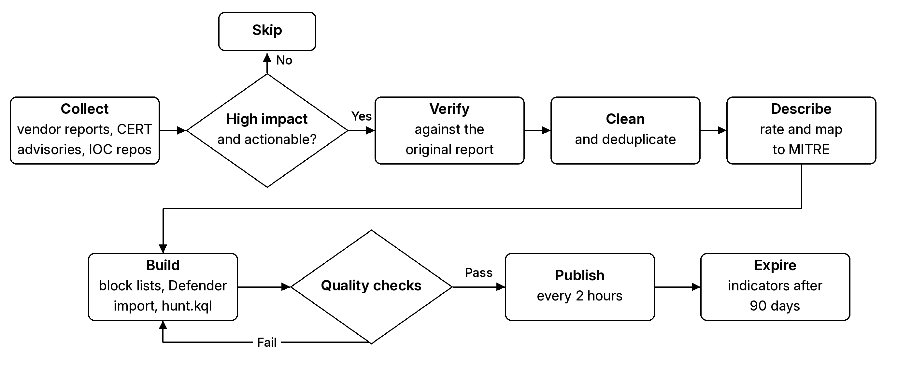

<div align="center">

<picture>
  <source media="(prefers-color-scheme: dark)" srcset="assets/banner-dark.webp">
  
</picture>

**Agentic AI collects it. Analysts verify it. Community acts on it.**<br>
<sub>AI threat intel from defenders, for defenders.</sub>

[](LICENSE) [](#latest-threats)   [](CONTRIBUTING.md)

</div>

<a id="what-is-this"></a>
<a id="why-this-exists"></a>
## Overview

When a serious attack breaks, the indicators SOC teams need are scattered across reports, often buried in PDFs and in formats no security tool can load directly. Commercial feeds are expensive and bury the attacks that matter under low-value indicators, and most teams do not have time to dig through every source themselves. This project does that work once, for everyone, focusing on attacks against banking, insurance and financial services, UK organisations and critical systems such as identity providers, edge devices and core enterprise software. Each threat comes with a short research summary, curated indicators that each have a description and a source, and ready-to-use block lists, Defender XDR import files and hunt queries.

> [!CAUTION]
> **Handle all indicators as live and malicious.** Do not visit, open, download or resolve any IP address, domain, URL or file listed here from a corporate or personal device. Analyse them only in an isolated environment, such as a hosted sandbox like [ANY.RUN](https://any.run/) or a self-hosted one like [OpenSandbox](https://github.com/opensandbox-group/OpenSandbox), and follow your organisation's security policies. These indicators are provided for defensive use only, and the maintainers accept no responsibility for any damage, data loss or policy breach caused by their misuse or careless handling.

## How it works

An autonomous agentic system runs 24/7, collecting threat intel from vendor research, CERT advisories, IOC repos, dark-web trackers, Telegram and social media. Anything without real impact or actionable IOCs and IOAs is dropped by design. Every indicator is cross-checked against independent sources and weighed on likelihood before it passes the acceptance gate. Intel is published every 2 hours, and analysts review every verdict.

Threats move fast. Defenders have to as well.

<picture>
  <source media="(prefers-color-scheme: dark)" srcset="assets/how-it-works-dark.png">
  
</picture>

## Quick start

1. **Block now:** Point your firewall, proxy or EDR at a [raw feed URL](#raw-feeds), or import [`defender_xdr_indicators.csv`](all/defender_xdr_indicators.csv) into Defender ([how](docs/defender-xdr.md#import-indicators)).
2. **Hunt in Defender:** Paste [`live_feed_hunt.kql`](all/live_feed_hunt.kql) into Advanced hunting. It loads the latest indicators itself, so there is nothing to copy in ([guide](docs/defender-xdr.md#hunt-with-the-live-feed)).
3. **Hunt in Splunk:** Load [`splunk_rti_iocs.csv`](all/splunk_rti_iocs.csv) as a lookup and run [`live_feed_hunt.spl`](all/live_feed_hunt.spl) ([guide](docs/splunk.md)).
4. **Detect in Google SecOps:** Load the feeds into data tables and run [`live_feed.yaral`](all/live_feed.yaral) ([guide](docs/google-secops.md)).

## Latest threats

Grouped by the month and day they were added, newest first. The date column is when the main source report was published. Last updated 2026-11-12 09:50.

### [November 2026](threats/2026-11_November-2026/)

#### [2026-11-12](threats/2026-11_November-2026/2026-11-12/)

| Date | Threat | Category | IOCs | Block now | Summary |
|---|---|---|---|---|---|
| 2026-11-11 | [Silent Lynx Strix AI-Agent Espionage Against Tajikistan](threats/2026-11_November-2026/2026-11-12/Silent-Lynx-Strix-AI-Agent-Espionage-Tajikistan/) | Espionage / APT | 22 | 13 | CloudSEK found an exposed server belonging to Silent Lynx (UAT-6275 at Cisco Talos, TAG-193 at Recorded Future), a Ka... |
| 2026-11-09 | [Able2Shell N-able N-central Zero-Days](threats/2026-11_November-2026/2026-11-12/Able2Shell-N-able-N-central-Zero-Days/) | Exploitation / MSP RMM | 4 | 1 | Public N-central RCE chains that still work on HF2, honeypot exploitation seen; hunt the server and N-able Agent activity |
| 2026-11-11 | [GSocket Linux Web-Server C2](threats/2026-11_November-2026/2026-11-12/GSocket-Linux-Web-Server-C2/) | Post-exploitation / Linux C2 | 9 | 4 | GSocket relay clients on compromised Linux web servers, with hashes and paths only — do not block the public relay |
| 2026-11-09 | [ARTEX AWS Financial-Data Hunting](threats/2026-11_November-2026/2026-11-12/ARTEX-AWS-Financial-Data-Hunting/) | Financially motivated intrusion / cloud | 10 | 0 | ARTEX operators in AWS hunting financial logs and Cognito, with hunt-only operator IPs |
| 2026-10-13 | [Ivanti Connect Secure UTA0576 CVE-2026-118527](threats/2026-11_November-2026/2026-11-12/Ivanti-Connect-Secure-UTA0576-CVE-2026-118527/) | Exploitation / VPN appliance | 2 | 0 | UTA0576 chaining Ivanti Connect Secure zero-days to steal LAPS, BitLocker and AD credentials |
| 2026-11-11 | [Falcon C2 (XG): Browser Framework and Antino Implant Targeting Government Webmail](threats/2026-11_November-2026/2026-11-12/Falcon-C2-XG-Antino-Browser-Implant/) | APT / browser implant | 27 | 27 | Browser C2 framework and Antino implant used against government webmail, with a malicious extension and OneDrive C2 |
| 2026-11-11 | [AntiFox: ARTEX Fork Used to Implant IIS Web Shells and Steal AWS Secrets](threats/2026-11_November-2026/2026-11-12/AntiFox-ARTEX-Fork-IIS-AWS-Secret-Theft/) | Exploitation / cloud credential theft | 2 | 0 | ARTEX fork used to implant IIS web shells and steal AWS production secrets |
| 2026-11-08 | [Operation Snowball: Cisco BroadWorks CVE-2026-20320 Exploited Against a European Telecom](threats/2026-11_November-2026/2026-11-12/Operation-Snowball-Cisco-BroadWorks-CVE-2026-20320/) | Exploitation / telecom | 4 | 0 | AI-driven intrusion of a European telecom through exploited Cisco BroadWorks CVE-2026-20320 |
| 2026-11-10 | [Outlook CVE-2026-124194: Exploited NTLM Hash Leak (Hunt Only)](threats/2026-11_November-2026/2026-11-12/Outlook-CVE-2026-124194-NTLM-Hash-Leak/) | Exploitation / credential theft | 1 | 0 | Exploited Outlook flaw that leaks NTLMv2 hashes, with no published network indicators |
| 2026-11-11 | [wfx: Hijacked GitHub Accounts Plant a CI Secret Stealer in Thousands of Repositories](threats/2026-11_November-2026/2026-11-12/GitHub-Hijacked-Accounts-wfx-CI-Secret-Stealer/) | Supply chain / CI/CD | 11 | 4 | Stolen GitHub accounts plant a CI secret stealer that exfiltrates repository secrets and backdoors cloud accounts |

#### [2026-11-11](threats/2026-11_November-2026/2026-11-11/)

| Date | Threat | Category | IOCs | Block now | Summary |
|---|---|---|---|---|---|
| 2026-11-11 | [ScreenConnect Cloud Panel Hijack: Rogue Clients Pushed to MSP-Managed Endpoints](threats/2026-11_November-2026/2026-11-11/ScreenConnect-Cloud-Panel-Hijack-MSP-Rogue-Client-Campaign/) | Supply chain / MSP remote access | 39 | 8 | Hijacked cloud ScreenConnect panels push rogue clients to MSP-managed endpoints and pivot back to technicians |
| 2026-11-11 | [Trigram: DPRK Dropper Chain Targeting AI, Blockchain and Logistics (Kimsuky / UNK_DeadDrop)](threats/2026-11_November-2026/2026-11-11/Trigram-DPRK-Dropper-Kimsuky-UNK-DeadDrop/) | APT / infostealer | 275 | 11 | DPRK ClickFix and supply-chain dropper, tied to Kimsuky and UNK_DeadDrop, that steals wallets and credentials |
| 2026-10-27 | [SkyW4lker: Microsoft 365 Device-Code Phishing Kit Targeting Enterprises](threats/2026-11_November-2026/2026-11-11/SkyW4lker-Microsoft-365-Device-Code-Phishing/) | Phishing / identity | 90 | 0 | Microsoft 365 device-code phishing kit that obtains tokens through genuine sign-in and MFA |
| 2026-10-05 | [Gentlemen Ransomware Affiliate Azazel: CI/CD Secret Theft, LEAKNED Extortion and MCP Command Execution](threats/2026-11_November-2026/2026-11-11/Gentlemen-Affiliate-Azazel-LEAKNED-CICD-Secret-Theft/) | Ransomware / data theft and extortion | 9 | 3 | Gentlemen ransomware affiliate stealing CI/CD secrets and leaking victims on its own LEAKNED site |
| 2026-11-10 | [Xen Orchestra Authentication Bypass (VSA-2026-062) Exploited to Take Over XCP-ng Hosts](threats/2026-11_November-2026/2026-11-11/Xen-Orchestra-VSA-2026-062-Auth-Bypass-XCP-ng-Takeover/) | Exploitation / hypervisor management | 17 | 2 | Cookie-based auth bypass in the Xen Orchestra console exploited to take over XCP-ng hosts as root |
| 2026-11-10 | [GhostFrame: ESXi Hypervisor Implant Linked to Settra Ransomware (TAG-218)](threats/2026-11_November-2026/2026-11-11/GhostFrame-ESXi-Hypervisor-Implant-Settra-Ransomware/) | Ransomware / hypervisor | 4 | 4 | ESXi hypervisor implant used by a Settra-linked group after VPN appliance intrusions in the US and Europe |
| 2026-11-06 | [Storm-3358 ARTEX Agentic Intrusions Against the Financial Sector](threats/2026-11_November-2026/2026-11-11/Storm-3358-ARTEX-Agentic-Intrusions-Financial-Sector/) | Financially motivated intrusion / financial sector | 8 | 8 | Agentic AI framework used to exploit web apps at banks and drop WISP, vshell and AdaptixC2 RATs |

#### [2026-11-10](threats/2026-11_November-2026/2026-11-10/)

| Date | Threat | Category | IOCs | Block now | Summary |
|---|---|---|---|---|---|
| 2026-11-09 | [AhsayCBS Backup Server Exploitation: Webshells, Cryptominer and Python Implant](threats/2026-11_November-2026/2026-11-10/AhsayCBS-Backup-Server-Exploitation-Webshells-Python-Implant/) | Exploitation / backup server | 25 | 16 | Backup server auth bypass and RCE used to plant webshells, a cryptominer and a Python implant |
| 2026-11-10 | [CopperDragon: China-Nexus Sparrow Framework Targeting Government and Telecoms](threats/2026-11_November-2026/2026-11-10/CopperDragon-Sparrow-Framework-China-Nexus-Espionage/) | APT / espionage | 158 | 116 | China-nexus Sparrow malware supplier behind espionage against government and telecoms in 21 countries |
| 2026-11-06 | [NotC2: AWS-Native AI C2 Proof of Concept](threats/2026-11_November-2026/2026-11-10/NotC2-AWS-Native-AI-C2-Proof-of-Concept/) | Cloud / C2 | 2 | 0 | Proof-of-concept C2 built on AWS SQS, Lambda, SNS and Bedrock, with no network IOCs to block |
| 2026-11-04 | [Phexia: macOS ClickFix Stealer with Polygon C2](threats/2026-11_November-2026/2026-11-10/Phexia-macOS-ClickFix-Stealer-Polygon-C2/) | Malware / macOS | 48 | 25 | macOS ClickFix backdoor and stealer that resolves C2 from a Polygon smart contract |
| 2026-11-10 | [Turla Cereal: Exchange Server Espionage Toolset](threats/2026-11_November-2026/2026-11-10/Turla-Cereal-Exchange-Espionage-Toolset/) | APT / espionage | 26 | 18 | Russia-aligned Turla .NET toolset turning Exchange servers into passive backdoors |
| 2026-11-09 | [MSP Process GDAP Breach: Entra Token Abuse in Partner Tenants](threats/2026-11_November-2026/2026-11-10/MSP-Process-GDAP-Breach-Entra-Token-Abuse/) | Supply chain / identity | 57 | 2 | Stolen partner app secrets used for Graph token abuse in MSP customer tenants |
| 2026-11-09 | [Ethersphere bee-js and Swarm Desktop Supply-Chain Attack (SleepyDuck / evjawbreaker)](threats/2026-11_November-2026/2026-11-10/Ethersphere-bee-js-Swarm-Desktop-Supply-Chain-Attack/) | Supply chain / npm | 57 | 45 | Malicious npm and desktop releases dropping a backdoor with Ethereum-based C2 |
| 2026-11-09 | [BYOD Ransomware and Extortion: Vanderbilt University Attack](threats/2026-11_November-2026/2026-11-10/BYOD-Ransomware-Vanderbilt-University-Attack/) | Ransomware | 5 | 1 | New ransomware and extortion group claiming Vanderbilt University |
| 2026-11-08 | [SSHole: OpenSSH CVE-2026-123158 Exploitation and TAC Agent Implant](threats/2026-11_November-2026/2026-11-10/SSHole-OpenSSH-CVE-2026-123158-Exploitation/) | Exploitation / Linux | 40 | 15 | Password bypass on musl-based OpenSSH exploited to gain root and drop an implant |
| 2026-11-05 | [FreeSWITCH CVE-2026-116779 SIP Command Injection Cryptominer Campaign](threats/2026-11_November-2026/2026-11-10/FreeSWITCH-CVE-2026-116779-Cryptominer-Campaign/) | Exploitation / cryptomining | 12 | 6 | SIP MESSAGE command injection used to install a cryptominer |
| 2026-11-04 | [APT29 Watering Holes Targeting iOS and Android with N-Day Exploits](threats/2026-11_November-2026/2026-11-10/APT29-Mobile-Watering-Hole-Exploit-Chains/) | APT / espionage | 27 | 25 | Watering holes serving n-day exploit chains to iOS and Android visitors |

To block everything at once, use [`all/`](all/): 354 high-confidence block indicators across all threats.

<a id="how-to-use"></a>
## Use the data

| Tool | Guide |
|---|---|
| Live feed dashboard | [Browse threats, check an indicator, download files](docs/dashboard.md) |
| Microsoft Defender XDR | [Import indicators, run hunts, create detection rules](docs/defender-xdr.md) |
| Firewalls and EDR | [Use block lists as external dynamic lists](docs/firewall-and-edr.md) |
| Splunk | [Run hunts over CIM or raw data, live-feed lookup](docs/splunk.md) |
| Google SecOps | [Per-threat YARA-L 2.0 rules, data tables, live-feed rule](docs/google-secops.md) |
| Anything else | [Data format reference](docs/data-format.md) |

### Raw feeds

These stable links always serve the latest data. Use them as external dynamic lists or scheduled imports.

| Feed | Use | Raw URL |
|---|---|---|
| [`block_now_ipv4.txt`](all/block_now_ipv4.txt) | Firewall / EDR IP block list | https://raw.githubusercontent.com/daniyyell-dev/rapid-threat-intel/main/all/block_now_ipv4.txt |
| [`block_now_domain.txt`](all/block_now_domain.txt) | DNS / proxy domain block list | https://raw.githubusercontent.com/daniyyell-dev/rapid-threat-intel/main/all/block_now_domain.txt |
| [`block_now_url.txt`](all/block_now_url.txt) | Proxy / web filter URL block list | https://raw.githubusercontent.com/daniyyell-dev/rapid-threat-intel/main/all/block_now_url.txt |
| [`block_now_sha256.txt`](all/block_now_sha256.txt) | EDR SHA256 hash block list | https://raw.githubusercontent.com/daniyyell-dev/rapid-threat-intel/main/all/block_now_sha256.txt |
| [`block_now_sha1.txt`](all/block_now_sha1.txt) | EDR SHA1 hash block list | https://raw.githubusercontent.com/daniyyell-dev/rapid-threat-intel/main/all/block_now_sha1.txt |
| [`defender_xdr_indicators.csv`](all/defender_xdr_indicators.csv) | Defender XDR indicator import | https://raw.githubusercontent.com/daniyyell-dev/rapid-threat-intel/main/all/defender_xdr_indicators.csv |
| [`iocs.csv`](all/iocs.csv) | Every indicator with description and source, for a SIEM or TIP | https://raw.githubusercontent.com/daniyyell-dev/rapid-threat-intel/main/all/iocs.csv |

> [!WARNING]
> Hunt before you block, and test file-hash blocks on one host first where a threat abuses legitimate file names. Defender IP indicators only cover outbound connections from endpoints, so block inbound attacker IPs at the firewall.

<a id="repository-structure"></a>
## Repository

```text
rapid-threat-intel/
├── threats/
│   └── <YYYY-MM>_<Month-YYYY>/               one folder per month of entry, e.g. 2026-11_November-2026
│       ├── README.md                         that month's days and threats
│       └── <YYYY-MM-DD>/                     one folder per day of entry
│           ├── README.md                     that day's threats
│           └── <Threat-Name>/
│               ├── README.md                 summary, MITRE, actions, sources
│               ├── block_now.txt             high-confidence indicators to block
│               ├── iocs.csv                  every indicator with description and source
│               ├── defender_xdr_indicators.csv   Defender XDR bulk import
│               ├── hunt.kql                  Defender XDR advanced hunting query
│               ├── hunt.spl                  Splunk hunt (CIM data models)
│               ├── hunt_raw.spl              Splunk hunt for data not mapped to CIM
│               └── hunt.yaral                Google SecOps YARA-L 2.0 rule
├── all/                                      every threat combined
│   ├── block_now.txt
│   ├── block_now_<type>.txt                  one clean list per type for firewalls
│   ├── iocs.csv
│   ├── defender_xdr_indicators.csv
│   ├── live_feed_hunt.kql                    Defender hunt that loads the live feeds
│   ├── live_feed_hunt.spl                    Splunk hunt using the splunk_rti_iocs.csv lookup
│   ├── live_feed.yaral                       Google SecOps rule using reference lists
│   ├── splunk_rti_iocs.csv                   block-now indicators as a Splunk lookup
│   └── splunk_macros.conf                    rti_* macros for hunt_raw.spl
└── docs/                                     how-to guides
```

## Confidence and actions

| Value | Meaning |
|---|---|
| `block` | Attacker-owned infrastructure or malware. Safe to block. |
| `alert` | Likely malicious but shared, such as cloud, VPN or residential proxy IPs. Alert and investigate instead of blocking. |
| `monitor` | Context or a hunt lead, such as a file name. Watch for it; do not block. |
| `high` | Confirmed by the source with direct evidence. |
| `med` | Reported by a credible source but shared or not fully confirmed. |
| `low` | Weak or short-lived signal. Use for hunting only. |

`block_now.txt` contains only indicators that are both `high` and `block`.

## Data format

`iocs.csv` columns:

| Column | Description |
|---|---|
| `indicator` | The value, for example an IP, domain, URL or hash |
| `type` | `ipv4`, `domain`, `url`, `sha256`, `sha1`, `filename`, `email` and others |
| `threat` | Threat the indicator belongs to |
| `confidence` | `high`, `med` or `low` |
| `recommended_action` | `block`, `alert` or `monitor`. Every `block` indicator is `high` confidence |
| `source_url` | Report the indicator came from |
| `description` | One-line description of what it is |
| `notes` | Extra context from the source |
| `sources` | Every source that publishes the indicator, space-separated |

Full reference, including the Defender file and expiry: [docs/data-format.md](docs/data-format.md).

## Contributing

New indicators, corrections, false-positive reports and better detections are welcome. Read [CONTRIBUTING.md](CONTRIBUTING.md), then open an [issue](https://github.com/daniyyell-dev/rapid-threat-intel/issues/new/choose) or a pull request. To report a security problem privately, see [SECURITY.md](SECURITY.md).

<a id="acknowledgements"></a>
## Sources

Thanks to the organisations whose published research these indicators come from. Inclusion does not imply endorsement.

| Type | Sources |
| --- | --- |
| **Security research** | [Aikido](https://www.aikido.dev/blog) · [ANY.RUN](https://any.run/cybersecurity-blog/) · [Beazley Security](https://labs.beazley.security/) · [Bitdefender](https://www.bitdefender.com/) · [Check Point Research](https://research.checkpoint.com/) · [CloudSEK](https://www.cloudsek.com/) · [ConnectWise](https://www.connectwise.com/) · [Corgea](https://corgea.com/) · [Datadog Security Labs](https://securitylabs.datadoghq.com/) · [ESET](https://www.eset.com/) · [GreyNoise](https://www.greynoise.io/) · [Huntress](https://www.huntress.com/) · [Inforcer](https://www.inforcer.com/) · [Malbear Labs](https://malbearlabs.com/) · [Malwarebytes](https://www.malwarebytes.com/) · [Microsoft Threat Intelligence](https://www.microsoft.com/en-us/security/blog/) · [N-able](https://www.n-able.com/) · [Previdian](https://www.previdian.com/) · [Rapid7](https://www.rapid7.com/) · [Recorded Future](https://www.recordedfuture.com/research) · [SANS ISC](https://isc.sans.edu/) · [Sansec](https://sansec.io/) · [Sekoia](https://www.sekoia.com/) · [Socket](https://socket.dev/) · [Sophos](https://www.sophos.com/) · [Tenable](https://www.tenable.com/) · [Unit 42](https://unit42.paloaltonetworks.com/) · [Varonis](https://www.varonis.com/) · [Vates](https://vates.tech/) · [Volexity](https://www.volexity.com/) · [WithSecure](https://www.withsecure.com/) · [ZeroPath](https://zeropath.com/) |
| **Government / CERT** | [CERT-FR](https://www.cert.cyber.gouv.fr/) · [CISA](https://www.cisa.gov/) |
| **Community tracker** | [ransomware.live](https://www.ransomware.live/) · [Reddit r/msp](https://www.reddit.com/r/msp/) |
| **Security news** | [BleepingComputer](https://www.bleepingcomputer.com/) · [Infosecurity Magazine](https://www.infosecurity-magazine.com/) · [Nashville Banner](https://nashvillebanner.com/) · [SecurityWeek](https://www.securityweek.com/) · [The Hacker News](https://thehackernews.com/) · [The Stack](https://www.thestack.technology/) |
| **Also monitored** | [Mandiant / Google Threat Intelligence](https://cloud.google.com/security/mandiant) · [Cisco Talos](https://blog.talosintelligence.com/) · [Kaspersky Securelist](https://securelist.com/) · [SentinelLabs](https://www.sentinelone.com/labs/) · [Trend Micro](https://www.trendmicro.com/en_us/research.html) · [Sophos X-Ops](https://www.sophos.com/) · [CrowdStrike](https://www.crowdstrike.com/en-us/blog/) · [Elastic Security Labs](https://www.elastic.co/security-labs) · [Arctic Wolf](https://arcticwolf.com/resources/blog/) · [The DFIR Report](https://thedfirreport.com/) · [Wiz](https://www.wiz.io/blog) · [StepSecurity](https://www.stepsecurity.io/blog) · [CrowdSec](https://www.crowdsec.net/) · [watchTowr](https://labs.watchtowr.com/) · [VulnCheck](https://www.vulncheck.com/kev) · [Zscaler ThreatLabz](https://www.zscaler.com/blogs/security-research) · [JPCERT/CC](https://blogs.jpcert.or.jp/en/) · [FortiGuard Labs](https://www.fortinet.com/blog/threat-research) · [Group-IB](https://www.group-ib.com/blog/) · [Symantec](https://www.security.com/threat-intelligence) · [Infoblox Threat Intel](https://www.infoblox.com/blog/threat-intelligence/) · [Black Lotus Labs](https://blog.lumen.com/) · [Red Canary](https://redcanary.com/blog/) · [Silent Push](https://www.silentpush.com/blog/) · [Hunt.io](https://hunt.io/blog) · [ReversingLabs](https://www.reversinglabs.com/blog) · [JFrog Security Research](https://jfrog.com/blog/) · [Orange Cyberdefense](https://www.orangecyberdefense.com/) · [HarfangLab](https://harfanglab.io/insidethreat/) · [abuse.ch](https://abuse.ch/) · [Censys](https://censys.com/blog/) · [NCSC UK](https://www.ncsc.gov.uk/) · [CERT-EU](https://cert.europa.eu/) · [ENISA](https://www.enisa.europa.eu/) · [FBI IC3](https://www.ic3.gov/) · [ACSC](https://www.cyber.gov.au/) · [NSA Cybersecurity](https://www.nsa.gov/Cybersecurity/) · [Canadian Centre for Cyber Security](https://www.cyber.gc.ca/) · [BSI](https://www.bsi.bund.de/) · [NHS England Cyber Alerts](https://digital.nhs.uk/cyber-alerts) · [FS-ISAC](https://www.fsisac.com/) · [The Record](https://therecord.media/) · [Splunk Threat Research](https://www.splunk.com/en_us/blog/security.html) · [IBM X-Force](https://www.ibm.com/think/x-force) · [Cloudflare Cloudforce One](https://www.cloudflare.com/cloudforce-one/research/) · [Akamai SIRT](https://www.akamai.com/blog/security-research) · [Trellix Advanced Research Center](https://www.trellix.com/blogs/research/) · [Netskope Threat Labs](https://threatlabs.netskope.com/blog/) · [LevelBlue SpiderLabs](https://www.levelblue.com/blogs/spiderlabs-blog) · [Securonix Threat Labs](https://www.securonix.com/blog/) · [CERT Polska](https://cert.pl/en/) · [CERT-UA](https://cert.gov.ua/articles) · [Push Security](https://pushsecurity.com/blog) · [Permiso](https://permiso.io/blog) · [Detections AI](https://detections.ai/resources/blog) |

## Disclaimer

> [!NOTE]
> Everything here is provided as is, for defensive use only. Infrastructure changes hands quickly, so verify indicators against your environment before blocking in production.

## Licence

Released under the [MIT Licence](LICENSE).

## Sponsored by

<p>
<a href="https://prynoid.com/"><picture><source media="(prefers-color-scheme: dark)" srcset="site/img/sponsors/prynoid.webp"></picture></a>&nbsp;&nbsp;&nbsp;&nbsp;&nbsp;&nbsp;<a href="https://phishcore.io/"></a>
</p>

<p><a href="https://buymeacoffee.com/daniyyell" target="_blank" rel="noopener"></a></p>

## Limitations

This is not a full threat feed. We leave out routine threat intel and noise, and only publish confirmed attacks that are actively happening and have high impact. We also watch Telegram channels, dark-web leak posts, social media and security websites for early warning. A threat only goes in once a reputable vendor, researcher or government source publishes indicators for it. Unverified claims are never published. Because we focus on the threats that matter, some activity will be missing on purpose. If you think we've missed something important, please [open an issue](https://github.com/daniyyell-dev/rapid-threat-intel/issues/new/choose) or contribute through the [contributing guide](CONTRIBUTING.md).
